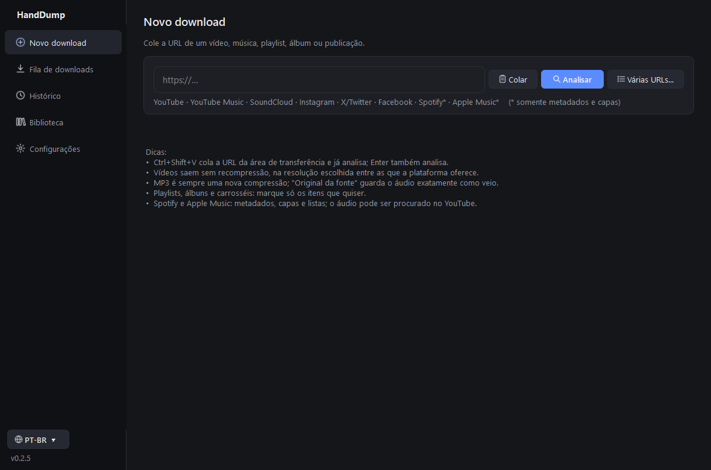
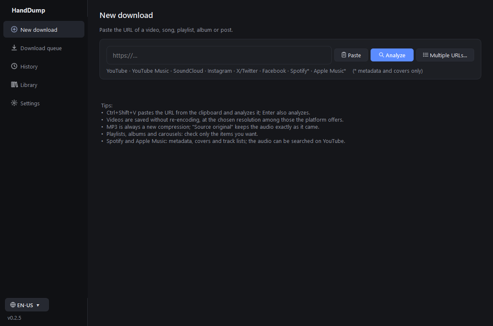

# HandDump

**Português** · [English](#english)

Aplicativo para Windows 10/11 que baixa vídeo, áudio, capas e metadados direto da fonte, sem
recompressão e sem contornar DRM, login ou paywall.

## Download

Baixe a versão mais recente em **[Releases](../../releases/latest)**:

| Arquivo | Para quem |
|---|---|
| `HandDump-<versão>-Setup.exe` | **Instalador.** Cria atalhos no Menu Iniciar e um desinstalador. |
| `HandDump-<versão>-Portatil.exe` | **Portátil.** Um único arquivo, não precisa instalar. |
| `HandDump-<versão>-Portatil.zip` | O portátil com o LEIA-ME e as licenças. |
| `SHA256SUMS.txt` | Somas para conferir se os arquivos chegaram íntegros. |

O Windows SmartScreen pode avisar porque o executável não tem assinatura digital: clique em
**Mais informações → Executar assim mesmo**.

## O que ele faz

- **YouTube e YouTube Music:** vídeo em todas as resoluções oferecidas (MP4 sem recompressão),
  áudio (MP3 320, M4A, FLAC, WAV ou original), capa, playlists e álbuns.
- **TikTok:** vídeos públicos (sem marca d'água quando o TikTok oferece), áudio e capa, por links
  completos ou encurtados (vm.tiktok.com, vt.tiktok.com).
- **Google Drive:** arquivos e pastas compartilhados por link; cada vídeo ou música da pasta (e das
  subpastas) vira um download na fila.
- **SoundCloud, Instagram, X/Twitter e Facebook:** vídeos, áudio e carrosséis públicos; fotos das
  publicações em resolução original e GIFs salvos como GIF animado.
- **Spotify e Apple Music:** metadados, capas e listas de faixas (CSV/JSON). O áudio desses
  serviços tem DRM e não é baixado deles. Cada faixa pode ser procurada no YouTube Music (pelo
  ISRC e por artista e título), com os metadados do catálogo gravados no arquivo.
- Tela simples: cole o link e escolha Vídeo, Música ou Capa com um clique (a tela completa
  continua disponível). Playlists com milhares de itens, cada um com seu progresso.
- Baixe só um trecho (início e fim em horas, minutos e segundos), com corte exato.
- **Converter:** áudio (MP3, M4A, OGG, Opus, FLAC, WAV), vídeo (MP4, MKV, WebM, MOV, AVI, GIF) e
  imagem (PNG, JPG, WebP, ICO, GIF, BMP), inclusive MP4 para MP3 e MP3 para MP4 com a capa na tela.
- **Editar metadados:** todos os campos, a letra e a capa de músicas e vídeos, sem recompressão.
- Letras nas músicas (opcional), do LRCLIB: gravadas no arquivo e, se quiser, num `.lrc`
  sincronizado ao lado. Só são aceitas quando artista e duração conferem.
- Histórico, biblioteca, tema escuro/claro, português e inglês, segundo plano na bandeja do
  sistema e aviso de atualizações (o app se atualiza sozinho, com verificação SHA-256).
- Conexões só por HTTPS, com certificado verificado, encerradas ao fim de cada download.

## Atualizar

- **Automático:** o app avisa quando há versão nova e se atualiza sozinho.
- **Instalado:** execute o `Setup.exe` da versão nova. Ele atualiza no lugar e mantém
  configurações e histórico.
- **Portátil:** troque o `.exe` antigo pelo novo na mesma pasta. A pasta `HandDump-dados`
  (configurações e histórico) continua valendo.

## Avisos

Use apenas com conteúdo que você tem direito de baixar. Os componentes de terceiros e suas
licenças estão em [THIRD_PARTY_NOTICES.txt](THIRD_PARTY_NOTICES.txt).

---

## English

Windows 10/11 app that downloads video, audio, covers and metadata straight from the source,
without re-encoding and without bypassing DRM, logins or paywalls.

### Download

Get the latest version from **[Releases](../../releases/latest)**:

| File | What it is |
|---|---|
| `HandDump-<version>-Setup.exe` | **Installer.** Adds Start menu shortcuts and an uninstaller. |
| `HandDump-<version>-Portatil.exe` | **Portable.** A single file, no installation needed. |
| `HandDump-<version>-Portatil.zip` | The portable app with the readme and licenses. |
| `SHA256SUMS.txt` | Checksums to verify the downloads. |

Windows SmartScreen may warn you because the executable is not digitally signed: click
**More info → Run anyway**.

### Features

- **YouTube and YouTube Music:** video at every resolution offered (MP4 without re-encoding),
  audio (MP3 320, M4A, FLAC, WAV or original), cover art, playlists and albums.
- **TikTok:** public videos (without watermark when TikTok offers it), audio and cover, from full
  or short links (vm.tiktok.com, vt.tiktok.com).
- **Google Drive:** files and folders shared by link; every video or song in the folder (and its
  subfolders) becomes a download in the queue.
- **SoundCloud, Instagram, X/Twitter and Facebook:** public videos, audio and carousels; post photos
  at original resolution and GIFs saved as real animated GIFs.
- **Spotify and Apple Music:** metadata, covers and track lists (CSV/JSON). Their audio is
  DRM-protected and is not downloaded from them. Each track can be matched on YouTube Music (by
  ISRC and by artist and title), with the catalog metadata written to the file.
- Simple screen: paste the link and choose Video, Music or Cover with one click (the full screen
  is still available). Playlists with thousands of items, each with its own progress.
- Download just a part (start and end in hours, minutes and seconds), with an exact cut.
- **Converter:** audio (MP3, M4A, OGG, Opus, FLAC, WAV), video (MP4, MKV, WebM, MOV, AVI, GIF) and
  images (PNG, JPG, WebP, ICO, GIF, BMP), including MP4 to MP3 and MP3 to MP4 with the cover on screen.
- **Edit metadata:** every field, lyrics and the cover of songs and videos, without re-encoding.
- Song lyrics (optional) from LRCLIB: written to the file and, if you like, to a synced `.lrc`
  next to it. Only used when the artist and duration match.
- History, library, dark/light theme, Portuguese and English, system tray mode and update
  notifications (the app updates itself, with SHA-256 verification).
- HTTPS-only connections with verified certificates, closed when each download ends.

### Updating

- **Automatic:** the app tells you when a new version is out and updates itself.
- **Installed:** run the new version's `Setup.exe`. It updates in place and keeps your settings
  and history.
- **Portable:** replace the old `.exe` with the new one in the same folder. The `HandDump-dados`
  folder (settings and history) keeps working.

### Notice

Only use it with content you are allowed to download. Third-party components and their
licenses are listed in [THIRD_PARTY_NOTICES.txt](THIRD_PARTY_NOTICES.txt).
